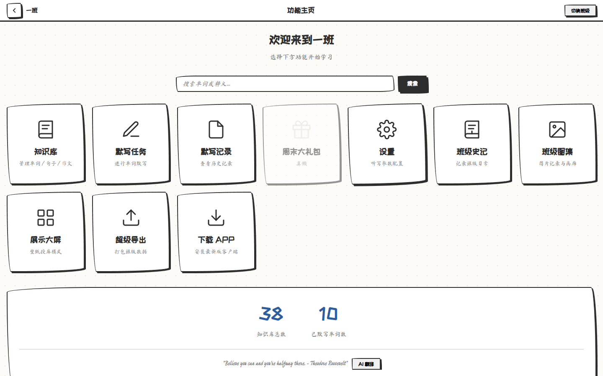
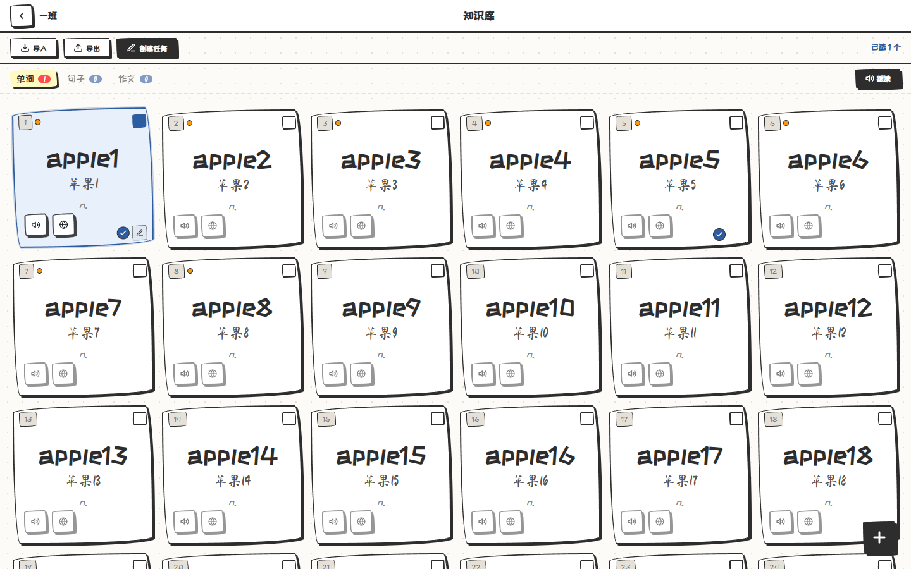
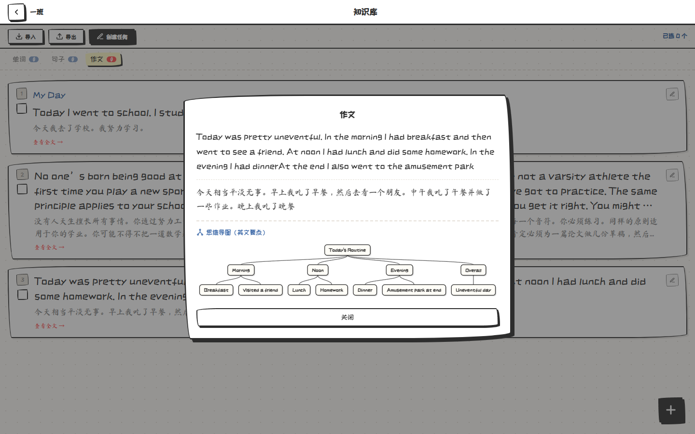
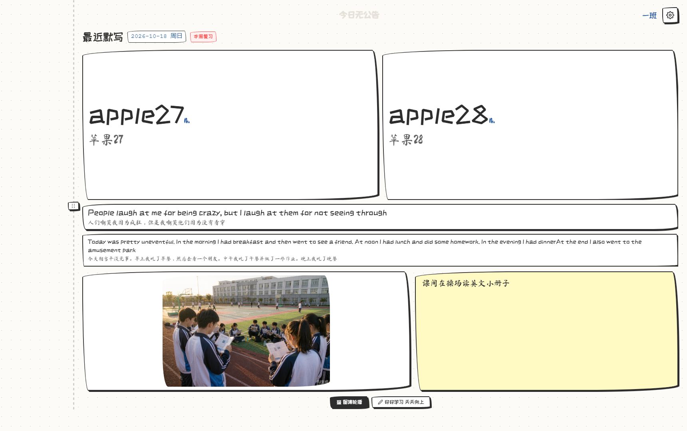
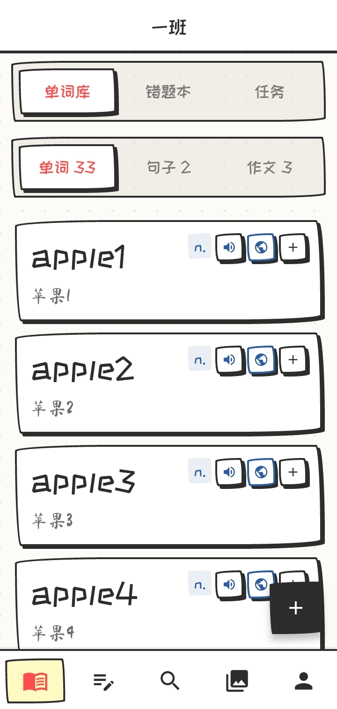
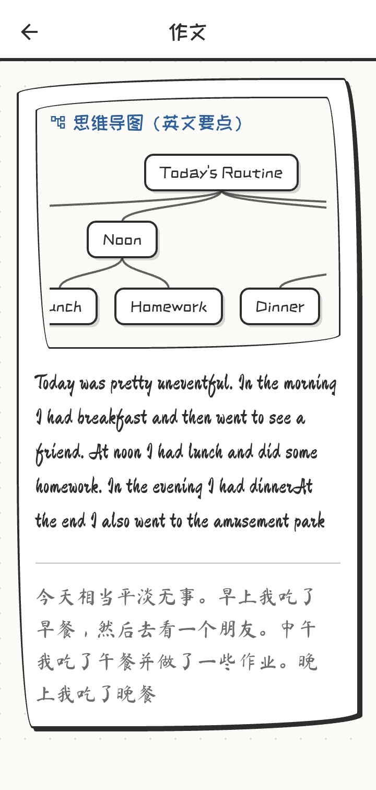

<p align="center"></p>

# ListenWrite · 默写史记

<p align="center">班级默写 + 班级史记 · 本地部署 · Web + Android</p>

班级默写 + 班级史记应用。本仓库为 **monorepo**，包含 Web 端（PHP 后端 + 浏览器前端）与 APP 端（Flutter Android 客户端）。

- **APP 名称**：ListenWrite　**Android 包名**：`billspace.listenwrite.flutter`　**当前版本**：`2.1.2`　**Web 版本**：`2.1.3`
- 历史版本与更新说明见 GitHub Releases 与 Web 端 `data/app_versions.json`
- **开源协议**：[GPL-3.0](LICENSE)
- **本应用为本地运行设计**：原线上服务器已下线，请在本地电脑启动服务，内网设备通过局域网访问。

## 功能亮点

- **知识库**：单词 / 句子 / 作文三类同库，AI 补全 / 直译、CSV 导入导出、跟读发音
- **默写任务**：看词 / 默写 / 听写三种模式，支持句子与作文；历史记录可一键重建任务
- **班级史记**：Quill 富文本 + 手写板 + 拖拽 / 粘贴插图 + PDF / 长图导出
- **班级图集**：图片 / GIF / MP4 / 实况照片，支持单文件与多文件上传、上传进度、视频首帧、1GB 视频分片上传、瀑布流、描述搜索（并入主页全局搜索）、点击排序、上传者显示与 7 天回收站
- **展示大屏**：免口令壁纸链接（公告跑马灯 + 今日单词 + 「好好学习 天天向上」；图集轮播已移除）
- **英文字体切换**：英文可在手写体与教学字体 **Andika** 之间切换（中文始终手写体）
- **作文思维导图（实验性）**：导入作文时可选 AI 生成英文要点树，默写时看要点写全文（可切换按中文默写）
- **本地优先**：Windows 一键安装 / 更新脚本，数据全部保存在自己电脑上
- **音乐播放器（班级配置）**：主界面入口，手绘转场后在新标签页打开本班配置的在线播放器；不占本机服务，需联网
- **小游戏**：内置 2048、别踩白块、拳皇（双人触屏）、人生重开模拟器、数独工坊；小游戏页顶部显示近 7 天游玩时长曲线，按班级设置每日游玩上限，每天 0 点重置

## 使用说明

完整图文手册（含目录、19 章、FAQ 与参数速查）：[web/docs/使用说明.md](web/docs/使用说明.md)。部署后也可直接访问 `/help.php` 查看同一份文档；截图制作规范见 [web/docs/截图清单.md](web/docs/截图清单.md)。

- **小游戏说明**：[web/docs/小游戏说明.md](web/docs/小游戏说明.md)（5 款内置游戏玩法与拳皇双人按键）

## 界面预览

| 功能主页 | 知识库（三板块） |
| :---: | :---: |
|  |  |

| 作文思维导图 | 展示大屏 |
| :---: | :---: |
|  |  |

| APP 单词库 | APP 作文导图 |
| :---: | :---: |
|  |  |


## 仓库结构

```
.
├── web/                          # Web 端 + 后端 API（PHP + JSON 文件存储，无数据库）
├── app/myapp/                    # Flutter APP 客户端（Android）
├── scripts/                      # 安装 / 启动脚本
│   ├── install.bat / install.ps1 # Windows 一键安装（PHP+ffmpeg+自启）
│   ├── update.bat / update.ps1   # Windows 一键更新
│   ├── uninstall.bat             # 移除开机自启
│   ├── run.bat / run-hidden.vbs  # 手动 / 隐藏启动服务
│   ├── dev.sh                    # 开发机（Linux/macOS/Termux）启动/停止
│   └── moxie                     # 快捷命令包装（默认后台启动）
├── .github/workflows/            # CI: APK 构建发布(build.yml) + Windows 安装脚本测试(install-windows.yml)
└── LICENSE
```

## 模块说明

| 目录 | 说明 | 文档 |
|------|------|------|
| [`web/`](web/) | 网站端 + APP 全部后端 API。PHP 8.0+（推荐 8.2），GD，cURL，JSON 文件存储 | [web/README.md](web/README.md) |
| [`app/myapp/`](app/myapp/) | Flutter APP 客户端，通过 `app_api.php` 与后端交互 | [app/myapp/README.md](app/myapp/README.md) |

## 快速开始

### 方式一：开发机（Linux / macOS / Termux）

```bash
./scripts/dev.sh          # 前台启动，Ctrl+C 停止
./scripts/dev.sh start    # 后台启动，并打印内网访问地址
./scripts/dev.sh status   # 查看状态
./scripts/dev.sh log      # 查看日志，log -f 持续跟随
./scripts/dev.sh stop     # 停止服务
./scripts/dev.sh restart  # 重启服务
# 浏览器打开 http://127.0.0.1:8000 或 http://<内网IP>:8000
```

也可以把快捷命令装进 `PATH`，以后直接使用 `moxie`：

```bash
mkdir -p ~/.local/bin
ln -sf "$PWD/scripts/moxie" ~/.local/bin/moxie

moxie            # 后台启动（已在运行则显示地址）
moxie status
moxie log
moxie stop
moxie restart
```

首次会在 `web/inc/config.php` 生成本地配置（已被 gitignore）。

### 方式二：Windows 用户（一键）

1. 获取本仓库代码（`git clone` 或下载 ZIP）
2. 双击 **`scripts\install.bat`**（自动请求管理员权限）：
   - 自动安装便携 PHP 8.2 与 ffmpeg 到 `runtime/`
   - **无网络也不怕**：若存在 `offline/php.zip` 与 `offline/ffmpeg.zip`，脚本会直接使用它们，无需联网下载（可用 U 盘携带）
   - 生成 `web/inc/config.php`
   - 注册**开机自启**计划任务、**放行防火墙**入站端口并启动服务
   - 控制台会打印内网访问地址（如 `http://192.168.x.x:8000`）
3. 其它设备连同一局域网，用该地址访问即可（防火墙已自动放行，无需手动确认弹窗）
4. 更新代码：双击 `scripts\update.bat`；卸载自启：`scripts\uninstall.bat`
   - git 仓库：自动 `git pull`；非 git（离线解压版）：自动从 GitHub 下载最新源码覆盖
   - 只更新代码，`web\data\`（数据）与 `web\inc\config.php`（配置）始终保留

> 部署、安全、数据存储、API 文档详见 [web/README.md](web/README.md)。

## APP 端构建

APP 端通过 GitHub Actions 自动构建 APK，无需本地 Flutter 环境。

1. 在**你自己的 fork/仓库** Settings → Secrets → Actions 添加 `API_BASE_URL`，值为你的后端地址（如 `http://192.168.1.10:8000`，不带尾部斜杠、不带 `/app_api.php`）
2. 手动运行 **Build APK** workflow 会产出 7 天有效的测试 artifact；推送 `app-v2.1.2` 这类 tag 才会正式发 Release 并更新 `apk-latest`
3. 构建完成后在 Actions artifact 或仓库 **Releases** 页下载 arm64 / armv7 两个 APK

> 如果未设置 `API_BASE_URL` Secret，CI 会使用 `api_config.example.dart` 中的本地地址（`127.0.0.1:8000`）。

详见 [app/myapp/README.md](app/myapp/README.md)。

## 运行要求与兼容性

| 项 | 最低要求 | 建议 |
|----|----------|------|
| Web 后端 | **PHP 8.0+**（代码使用 `str_contains` 等 PHP 8.0 特性） | **PHP 8.2 / 8.3** |
| Web 扩展 | GD、cURL、mbstring、fileinfo | 一键更新另需 zip；视频首帧另需 ffmpeg（可选） |
| APP | **Android 7.0（API 24）+** | Android 8.0+；CI 使用 Flutter 3.50.1 构建 |
| Web 要求 APP | **2.0.0+** | 当前 APP 正式版 2.1.2 |
| APP 要求 Web | **2.0.0+** | 当前 Web 正式版 2.1.3 |

> 当前正式版本：**Web 2.1.3 / APP 2.1.2**。最低兼容版本由 `web/inc/version.php` 与 `web/data/app_versions.json` 控制。
>
> 压缩功能已暂停：Web 与 APP 上传时均保留原文件，不再提供图片/视频压缩与前后对比。

## 技术栈

| 模块 | 技术 |
|------|------|
| Web 后端 | PHP 8.0+（推荐 8.2），GD，cURL，JSON 文件存储（无数据库）；调用 ffmpeg 可执行文件生成视频首帧缩略图（可选） |
| Web 前端 | 原生 HTML/CSS/JS，Quill 2.x 富文本编辑器（本地），按班级自定义 AI（OpenAI 兼容 / Anthropic） |
| APP | Flutter（Dart 3.5+），Provider，flutter_quill，cached_network_image |
| APP 字体 | ZCOOL KuaiLe + Ma Shan Zheng（打包到 APK；Web 端自托管于 `web/fonts/`，另含可选英文 Andika） |
| APP 音频 | just_audio（有道词典 TTS 在线发音） |
| CI/CD | GitHub Actions（Flutter stable + Java 17） |

## 数据存储

```
data/
├── classes.json              # 全局班级注册表
├── settings.json             # 全局设置（含按班级的 AI 配置 ai_{classId}）
├── app_versions.json         # APP 版本发布记录
├── announcements.json        # 全服公告
├── ratelimit.json            # 限流计数
├── users/                    # APP 用户数据（每个用户独立文件）
└── classes/                  # 班级数据（words/tasks/history/gallery/...）
```

> `web/data/` 为运行时数据，已被 gitignore，仅保留 `.htaccess`（本地由 `router.php` 保护）。

## 安全

- `web/inc/config.php`（含密钥）→ `.gitignore` 忽略，不入库
- `web/data/` 运行时数据 → 忽略；`router.php` 拦截直链
- `app/myapp/lib/config/api_config.dart`（含服务器地址）→ 忽略
- 部署安全加固与数据说明见 [web/README.md](web/README.md)
