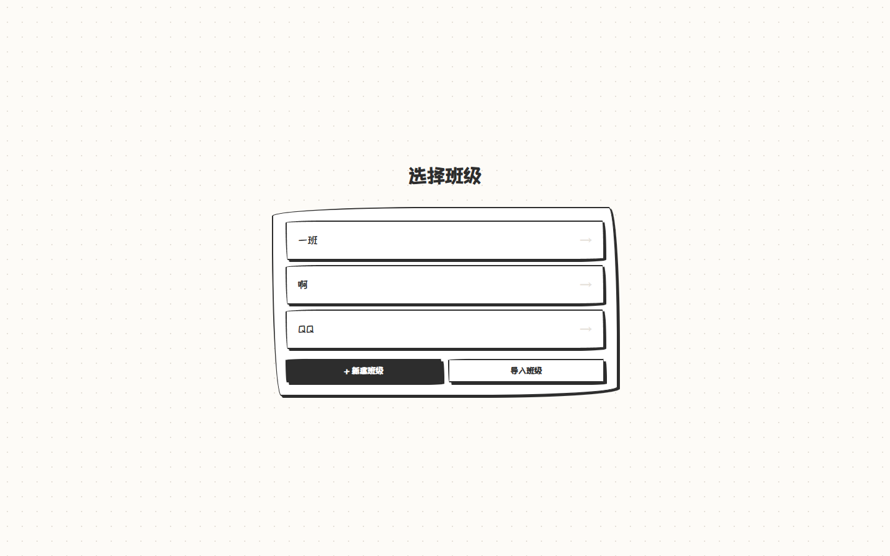
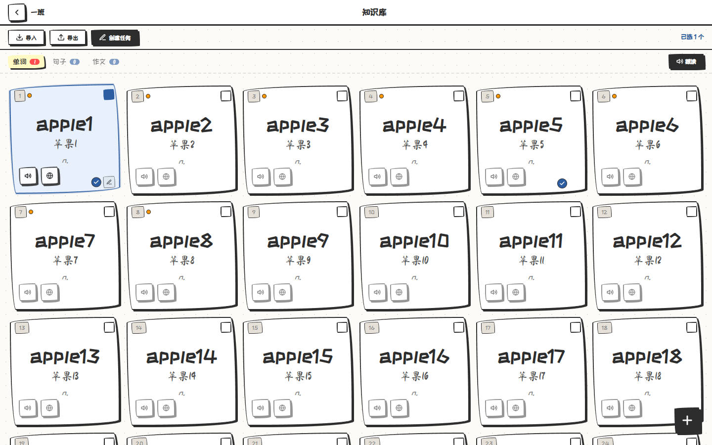
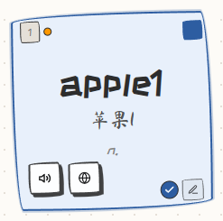
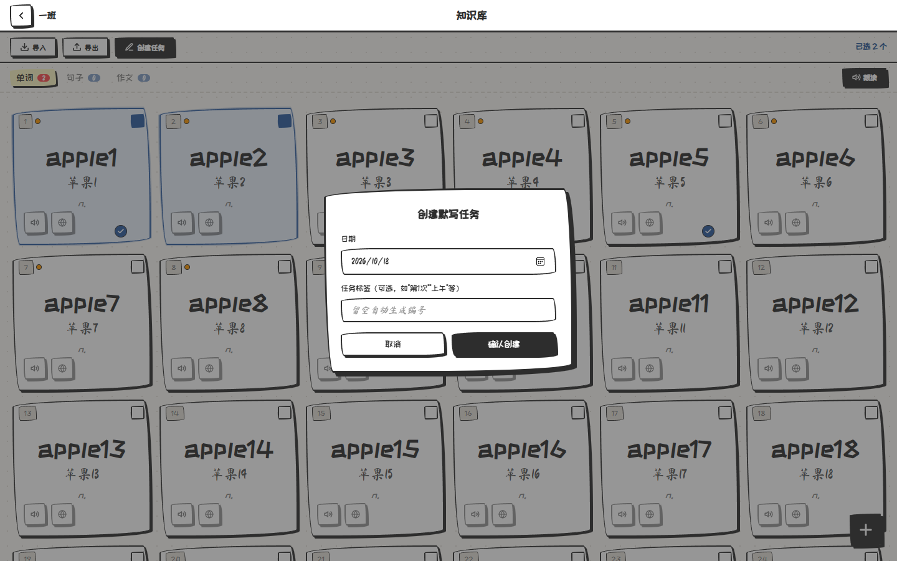
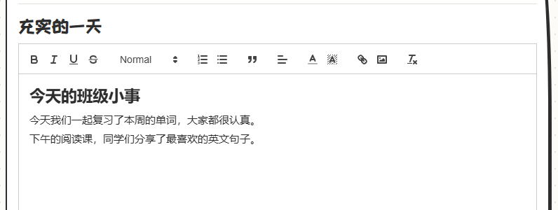
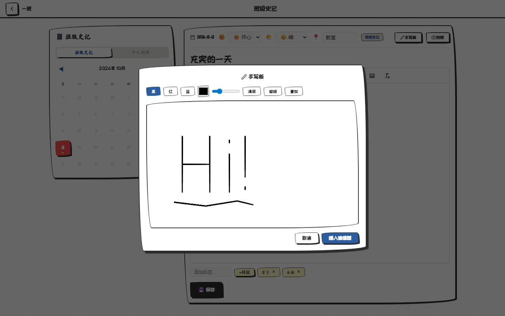
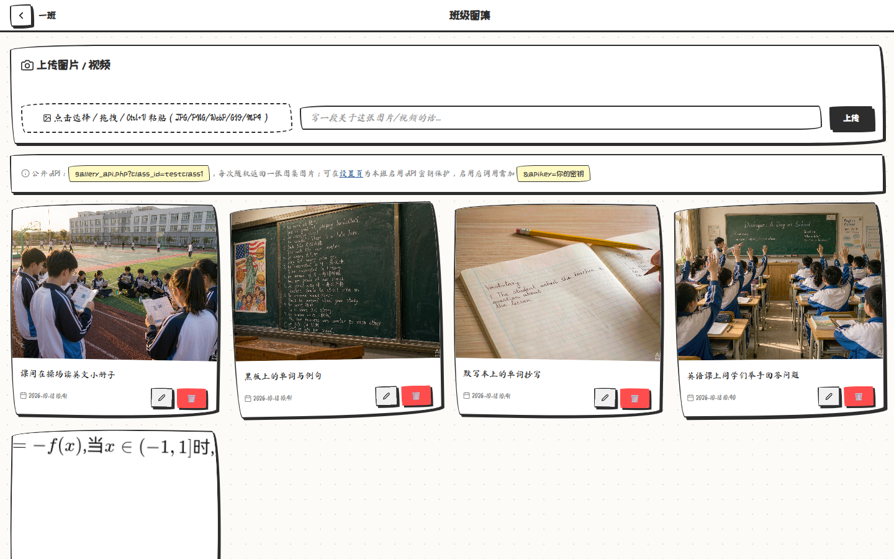

# ListenWrite 使用说明（完整版）

> 班级默写 + 班级史记 · 在自己的电脑上运行 · Web 与 Android APP 共用数据

本说明适用于 **ListenWrite 1.2.2**，面向使用本应用的老师与同学，同时包含管理员维护、AI 配置、数据备份等完整内容。

- **Web 端**：电脑上运行服务，手机 / 平板 / 其它电脑通过浏览器访问。
- **APP 端**：Android 客户端，与 Web 端共用同一套班级数据。
- **数据位置**：全部保存在运行服务的电脑上（`web/data/`），不上传云端。

## 目录

1. [产品简介](#一产品简介)
2. [安装与首次使用](#二安装与首次使用)
3. [班级管理](#三班级管理)
4. [功能主页](#四功能主页)
5. [知识库](#五知识库)
6. [发音与跟读](#六发音与跟读)
7. [默写任务](#七默写任务)
8. [默写记录](#八默写记录)
9. [班级史记](#九班级史记)
10. [班级图集](#十班级图集)
11. [展示大屏](#十一展示大屏)
12. [班级设置](#十二班级设置)
13. [AI 设置与智能功能](#十三ai-设置与智能功能)
14. [超级导出与班级导入](#十四超级导出与班级导入)
15. [APP 客户端](#十五app-客户端)
16. [管理员功能](#十六管理员功能)
17. [数据、备份与更新](#十七数据备份与更新)
18. [常见问题](#十八常见问题)
19. [附录：参数与限额速查](#十九附录参数与限额速查)

## 一、产品简介

ListenWrite 是一个「班级单词默写 + 班级史记」工具。它不依赖云服务器，而是把整套服务运行在老师自己的 Windows 电脑（或 Linux / macOS 开发机）上；同一局域网内的手机、平板、教室大屏通过浏览器或 APP 访问。

### 1.1 它能做什么

| 模块 | 主要用途 |
|------|----------|
| 知识库 | 统一管理 **单词 / 句子 / 作文**，支持 AI 补全、直译、CSV 导入导出 |
| 默写任务 | 从知识库勾选内容创建任务，支持 **展示 / 默写 / 听写** 三种模式 |
| 默写记录 | 查看已完成、已取消的历史任务，并可一键重建 |
| 班级史记 | 富文本日记、手写板、插图、心情 / 天气 / 地点 / 标签；支持个人列传 |
| 班级图集 | 图片 / GIF / MP4 照片墙，支持描述、灯箱查看与公开 API |
| 展示大屏 | 免口令壁纸链接：公告跑马灯 + 最近任务 + 图集轮播 |
| 设置 | 内网地址、英文字体、作文默写方式、听写 / 朗读 / 跟读参数、AI 接口 |
| 超级导出 | 把班级数据打包成 zip，用于备份或迁移到另一台电脑 |
| APP | Android 客户端：学习、生活、搜索、画廊、我的 |

### 1.2 本版值得注意的新功能（1.2.2）

- **内网主网址**：首页引导弹窗与班级设置页顶部都会显示当前局域网访问地址，可一键复制。
- **英文字体切换**：英文可在默认手写体与教学字体 **Andika** 之间切换，中文始终使用手写体。
- **作文思维导图（实验性）**：导入作文时可选让 AI 生成英文要点树；默写时看要点写全文。
- **展示大屏三板块**：最近任务中的单词、句子、作文都会展示，作文按作文库卡片样式呈现。
- **长单词 / 长句跑马灯修复**：知识库卡片中的超长内容在旧设备上也能正常来回滚动。
- **AI 连接兼容修复**：兼容 Windows 便携版 PHP 缺少 HTTPS 根证书的情况。

### 1.3 阅读约定

- 文中「点击」在手机上指「轻触」；「长按」指按住不放约 1 秒。
- 带 **＋** 的按钮通常是新增；右下角圆形按钮是当前板块的快捷添加。
- 文中提到的「班级口令」是进入班级的口令，不是 APP 账号密码，两者不同。

## 二、安装与首次使用

### 2.1 Windows 一键安装（推荐）

1. 取得完整程序目录（`git clone`、下载 ZIP 解压，或使用离线安装包）。
2. 双击 **`scripts\install.bat`**。脚本会自动请求管理员权限，请不要拒绝。
3. 安装脚本会依次完成：
   - 准备便携版 PHP 8.2 到 `runtime\php`；
   - 准备 ffmpeg 到 `runtime\ffmpeg`（用于 MP4 首帧缩略图，可选）；
   - 生成 `web\inc\config.php`（随机密钥），并在控制台打印管理员后台口令；
   - 注册开机自启计划任务、放行防火墙入站端口；
   - 启动本地服务，并打印本机地址与内网地址。
4. 记下控制台打印的 **内网主网址**（形如 `http://192.168.1.23:8000`）。
5. 手机 / 平板 / 其它电脑连接 **同一个 WiFi**，在浏览器打开该地址。
6. 首次打开会看到引导弹窗，按「下一步」了解各功能；也可以点「跳过」。

> **离线安装**：如果目录中存在 `offline\php.zip` 与 `offline\ffmpeg.zip`，安装脚本会直接使用它们，全程无需联网。适合把整个文件夹拷到 U 盘带到没有网络的教室电脑。

### 2.2 开发机（Linux / macOS）

```bash
./scripts/dev.sh
# 监听 0.0.0.0:8000，并打印内网访问地址
```

首次运行会在 `web/inc/config.php` 生成本地配置（该文件已被 gitignore，不会入库）。

### 2.3 第一次打开

1. 浏览器打开内网主网址。
2. 如果还没有班级，页面会自动弹出「创建新班级」。
3. 输入班级名称（最多 30 个字符）与班级口令（至少 4 位，只能使用字母或数字）。
4. 创建成功后进入班级主页。
5. 建议先到「知识库」添加几条内容，再创建一次默写任务，确认声音、显示都正常。

### 2.4 找不到内网地址怎么办

- 在每个班级的 **设置** 页顶部，有「内网主网址」一栏，点「复制」即可。
- 首页首次引导弹窗的「内网访问」一步也会显示该地址。
- 也可以在运行服务的电脑上执行 `ipconfig`，找到「IPv4 地址」，再加上 `:8000`。
- 电脑重启或切换 WiFi 后 IP 可能变化，此时以设置页显示的地址为准。

> **外网 / 外地访问**：默认只能在同一个局域网内访问。如果需要在外面访问，需要额外的「内网穿透」服务，请联系运行本服务的管理员。

### 2.5 开机自启、手动启动与卸载

| 操作 | 方法 |
|------|------|
| 开机自动启动 | 安装脚本已注册计划任务，登录 Windows 后自动隐藏启动 |
| 手动前台启动 | 双击 `scripts\run.bat` |
| 隐藏启动 | `scripts\run-hidden.vbs` |
| 停止自启 | 双击 `scripts\uninstall.bat` |
| 更新代码 | 双击 `scripts\update.bat` |
| 重新安装 / 修复 | 再次双击 `scripts\install.bat`（可反复运行，不会删除数据） |

## 三、班级管理

### 3.1 选择班级

打开网站后首先进入「选择班级」页。页面会列出所有班级，点击任意班级即可进入；如果该班设置了口令，会弹出输入框。



- 已在本设备验证过的班级，会直接进入，不需要重复输入口令。
- 口令验证状态会保存在浏览器 Cookie 中，有效期约一年；老师重置口令后，旧验证会自动失效并要求重新输入。
- 忘记当前是哪个班，可从主页右上角「切换班级」返回。

### 3.2 新建班级

1. 点击「＋ 新建班级」。
2. 填写班级名称与口令。
3. 点击「确认创建」。

规则：

- 班级名称最多 30 个字符，不能与已有班级重名（不区分大小写）。
- 口令至少 4 位，只能包含 **英文字母和数字**，不能使用中文或符号。
- 口令区分大小写。
- 创建者会自动通过该班口令验证，并进入班级主页。

### 3.3 导入班级

如果你在另一台电脑上使用「超级导出」生成了 zip 备份，可以在这里恢复为一个新班级：

1. 点击「导入班级」。
2. 选择之前导出的 `.zip` 文件。
3. 输入 **新的班级名称** 与 **新的班级口令**。
4. 点击「导入」。

说明：

- 导入会创建一个全新的班级，不会覆盖现有班级。
- 压缩包上限 300MB，解压后上限 1GB。
- 导出文件 **不包含** 用户名、密码、个人列传等用户隐私数据；导入后 APP 用户需要重新注册 / 登录。
- 导入的「进行中任务」如果日期已经早于今天，会自动标记为「已取消」。

### 3.4 切换班级

在主页右上角点击「切换班级」，回到班级列表重新选择。切换不会清除任何数据，只是更换当前班级。

### 3.5 多个班级

一个服务可以创建多个班级，各班的知识库、任务、史记、图集、设置、AI 配置相互独立。适合一位老师带多个班，或同一台电脑给多个班级共用。

## 四、功能主页

进入班级后，首先看到功能主页。

### 4.1 功能卡片

| 卡片 | 作用 |
|------|------|
| 知识库 | 管理单词 / 句子 / 作文 |
| 默写任务 | 查看待办任务、进入默写 |
| 默写记录 | 查看已完成 / 已取消的历史任务 |
| 周末大礼包 | 周末加练（仅单词） |
| 设置 | 内网地址、字体、听写参数、AI 等 |
| 班级史记 | 班级日记与个人列传 |
| 班级图集 | 图片 / GIF / MP4 照片墙 |
| 展示大屏 | 壁纸 / 大屏展示页 |
| 超级导出 | 打包班级数据 |
| 下载 APP | 获取 Android 客户端 |

### 4.2 统计与名言

- **知识库总数**：当前班级知识库中的全部条目数（单词 + 句子 + 作文）。
- **已默写单词数**：所有「已完成」任务中去重后的条目数（界面沿用「单词」字样，实际也包含句子与作文）。
- 页面底部的英文名言每次进入随机显示；配置 AI 后可点「AI 翻译」查看中文，再点一次隐藏。

### 4.3 全局搜索

主页上方搜索框可以同时搜索三类内容：

1. **知识库**：匹配英文或中文释义，结果最多每次显示 10 条，可点「查看更多单词」继续加载。
2. **进行中任务**：匹配任务中包含的内容，显示日期、标签与匹配数量。
3. **默写历史**：在已完成 / 已取消任务中匹配。

点击搜索结果会跳转到对应页面并高亮定位；句子与作文结果会带 `[句]` / `[文]` 标记。

### 4.4 首次引导与重新查看

首次进入班级会显示 9 步引导，介绍内网访问、知识库、任务、搜索、字体、作文思维导图等。点「跳过」后不再自动出现。

需要重新查看时：进入「设置」页，点底部「重新查看引导弹窗」。

### 4.5 公告

管理员发布公告后，Web 端会在页面顶部显示滚动横幅；「超级霸屏」类型的公告会以全屏大字短暂显示。公告可以关闭，关闭状态按公告记录在本设备。

### 4.6 周末大礼包

- **周一至周五**：卡片显示「还没开放」，不可点击。
- **周末且本周完成过单词默写**：显示「给我加练」，点击后从本周已完成任务中随机抽取最多 20 个 **单词**，创建一次「周末大礼包」任务，并直接进入默写页。
- **周末但本周没有完成任何单词默写**：显示「真懒」，不可点击。
- **本周已经创建过**：显示「已完成」，点击可重新查看该任务。

说明：周末大礼包只抽单词，不包含句子与作文；每周只能创建一次。

## 五、知识库

知识库是全部学习内容的仓库，分为 **单词 / 句子 / 作文** 三个板块。



### 5.1 页面结构

- 顶部工具栏：**导入**（CSV）、**导出**（CSV）、**创建任务**、右侧「已选 N 个」。
- 板块标签：**单词 / 句子 / 作文**，标签右侧数字表示「当前已勾选该类内容的数量」，不是总数。
- 单词板块右上角有「跟读」按钮。
- 右下角 **＋** 按钮：单词板块打开「批量添加单词」，句子 / 作文板块打开对应添加弹窗。

### 5.2 单词卡片

每张单词卡包含：

- 左上角编号；如果该词出现在未完成任务中，会有一个橙色小圆点，鼠标悬停可看到默写日期。
- 右上角勾选框：点击卡片或勾选框可选中 / 取消。
- 中间英文与中文释义；内容过长时卡片内会来回滚动显示。
- 左下角两个发音按钮：**标准发音**（喇叭）与 **全球发音**（地球）。
- 右下角：蓝色对勾表示「已默写」；铅笔按钮用于编辑。
- 编辑弹窗中除了保存，还有「删除」按钮。

### 5.3 句子与作文卡片

- 句子卡：英文与中文各显示一行，超长自动跑马灯；点击卡片选中。
- 作文卡：显示标题、英文预览（最多 3 行）、中文预览（最多 2 行）和「查看全文 →」；点击正文区域打开详情，点击勾选框选中。
- 作文详情弹窗：显示标题、完整英文、完整中文；如果该作文有思维导图，还会显示「思维导图（英文要点）」。

### 5.4 添加单词

1. 在「单词」板块点右下角 **＋**。
2. 默认打开 **批量添加单词**：每行一个单词，可一次粘贴大量单词。
3. 点「AI 智能补全」，系统会把单词发给 AI，生成中文释义与词性，并进入预览。
4. 在预览中逐条检查：
   - 红色单词表示 AI 不确定，建议人工确认；
   - 灰色删除线表示词库中已存在，不会重复导入；
   - 可直接修改英文、释义、词性；
   - 修改英文后点 ✨ 可让 AI 重新补全该词；
   - 点 `x` 可移除该条。
5. 点「确认导入」。重复项会自动跳过，导入完成后列表原地刷新，不需要刷新页面。
6. 如果只想手动加一个词，点弹窗底部的「逐个添加单词」，填写英文、释义、词性（选填）后添加。

批量添加限制：单次最多 **100 个单词**。

### 5.5 添加句子

1. 切到「句子」板块，点 **＋**。
2. 输入英文句子。
3. 点「✨ AI 直译」可自动生成中文直译；也可以手动填写。
4. 点「添加」。

句子不会生成思维导图。

### 5.6 添加作文

1. 切到「作文」板块，点 **＋**。
2. 填写标题（选填）、英文作文、中文释义。
3. 可点「✨ AI 直译」生成中文直译。
4. 如果本班已配置 AI，会出现「**同时生成思维导图（英文要点树，用于按导图默写）**」勾选项：
   - 勾选后，保存时会调用 AI 生成思维导图，按钮会显示「正在生成思维导图…」；
   - 这是可选项，不勾选也能正常添加；
   - 生成失败时会提示「已添加，但思维导图生成失败」，作文本身仍会保存。
5. 点「添加」。

### 5.7 编辑与删除

- 单词 / 句子 / 作文都可以点卡片上的铅笔按钮编辑。
- 编辑弹窗底部有「删除」，删除后不可恢复，请谨慎操作。
- 同类型内容不能重名：单词、句子按英文内容查重，作文也按英文正文查重（不区分大小写）。句子与单词之间、作文与句子之间互不冲突。
- **编辑已有思维导图的作文**：如果修改了英文正文或标题，保存后会自动调用 AI **重新生成**思维导图；如果 AI 不可用或生成失败，作文会照常保存，旧导图保留，并提示「作文已保存，但思维导图未能重新生成」。如果只改中文释义，导图不会变化。
- 目前不支持手动编辑导图，也不支持给旧作文事后补生成导图；需要导图时，可以在添加新作文时勾选生成。

### 5.8 CSV 导入与导出

**导出**：点工具栏「导出」，会下载 UTF-8 BOM 的 CSV，列顺序为：

```text
英文,中文,词性,类型,标题
```

**导入**：点工具栏「导入」，选择 `.csv` 文件。列顺序与导出一致：

| 列 | 说明 |
|----|------|
| 英文 | 必填 |
| 中文 | 必填 |
| 词性 | 仅单词使用，可留空 |
| 类型 | `word` / `sentence` / `essay`，省略时按 `word` |
| 标题 | 仅作文使用，可留空 |

示例：

```csv
apple,苹果,n.,word,
I am fine.,我很好,,sentence,
My Day,我的一天,,essay,
```

导入时第一行如果是表头（如「单词,释义」）会自动跳过；重复内容会跳过并在结果中列出。

### 5.9 选中内容与创建任务

- 点击卡片可选中 / 取消，顶部显示「已选 N 个」。
- 单词最多选 **20 个**；句子与作文 **不限数量**。
- 可以在不同板块之间切换连续选择，已选状态会保留。
- 选择完成后点工具栏「创建任务」，进入任务创建弹窗。

### 5.10 内容长度限制

| 类型 | 英文上限 | 中文上限 | 其它 |
|------|----------|----------|------|
| 单词 | 100 字符 | 500 字符 | 词性 50 字符 |
| 句子 | 500 字符 | 500 字符 | 无 |
| 作文 | 5000 字符 | 5000 字符 | 标题 200 字符 |

## 六、发音与跟读

### 6.1 标准发音

单词卡左下角的喇叭按钮使用有道词典的在线发音。点击后按「朗读设置」中的次数重复播放。

- 需要设备能访问互联网；离线时发音会失败。
- 朗读次数与重复间隔可在「设置 → 朗读设置」中调整。

### 6.2 全球发音（同学们录制的发音）



- **Web 端**：点击地球按钮，打开「全球发音」弹窗，列出本班同学为该单词录制的发音，点击任意一条播放。Web 端只负责听，不能录音。
- **APP 端**：短按地球按钮打开列表；**长按地球按钮**开始录音，松开后自动上传。录音太短会提示重录；同一用户对同一单词重复上传会覆盖旧录音。
- 如果还没有人录过，会提示「还没有人录过这个词」。

### 6.3 跟读

跟读只针对 **单词**，入口有两个：

- 知识库「单词」板块右上角「跟读」；
- 默写任务执行页顶部的「跟读」。

设置项：

| 设置 | 说明 |
|------|------|
| 单词范围 | 全部单词 / 已选单词 |
| 每个单词朗读次数 | 1–5 次 |
| 缓冲时间 | -0.5 至 5 秒；每遍读完后的停顿 = 音频时长 + 该值，最小为 0 |
| 随机乱序 | 只打乱跟读顺序，不改变知识库排序 |

播放器会在 3 秒后自动收起为左下角圆形气泡，点击气泡可重新展开；支持暂停 / 继续 / 停止。跟读过程中不能勾选内容，需先结束跟读。

## 七、默写任务

### 7.1 创建任务

1. 在知识库勾选内容（单词 ≤20，句子 / 作文不限）。
2. 点工具栏「创建任务」。
3. 选择日期（默认今天）。
4. 填写任务标签（可选，如「第 1 次」「上午」）；留空会自动命名为「任务 1」「任务 2」……
5. 点「确认创建」。

规则：

- 同一天不能有相同标签的两个任务；标签重复时会提示换一个名字。
- 任务内的顺序固定为：**单词 → 句子 → 作文**。
- 创建后会自动跳转到该任务的执行页。



### 7.2 任务列表

进入「默写任务」后，默认显示待办任务列表：

- 按日期分组，日期越早越靠前；今天的日期旁有蓝色「今天」标签。
- 每个任务显示标签，以及「N 单词 · N 句子 · N 作文」的组成。
- 点击任意任务进入执行页。
- 没有任务时，可直接点「前往单词库」创建。

> 过期规则：日期早于今天且仍未完成的任务，会在打开任务页或历史页时自动标记为「已取消」（当周周末大礼包除外）。

### 7.3 执行页与三种模式

执行页顶部有：**完成**、**取消**、**跟读**，以及模式切换「展示 / 默写 / 听写」。

| 模式 | 单词 | 句子 / 作文 | 说明 |
|------|------|-------------|------|
| 展示 | 英文 + 中文 + 词性 | 英文 + 中文 | 用于领读、讲解 |
| 默写 | 隐藏英文，放大中文 | 隐藏英文，显示中文；有导图的作文按设置显示导图 | 学生看中文写英文 |
| 听写 | 只播放单词发音，不显示内容 | 不参与 | 仅在任务 **只含单词** 时出现 |

补充说明：

- 任务中只要包含句子或作文，「听写」按钮就不会出现。
- 默写模式下会隐藏单词卡上的发音按钮，避免听音得到提示。
- 句子与作文按任务顺序显示在单词下方。
- 作文如果已生成思维导图，默写模式下默认只显示导图，学生看英文要点写全文；可在设置中改为「中文」。
- 没有思维导图的作文，会自动回退为「隐藏英文、显示中文」。

### 7.4 听写流程

1. 点「听写」，进入「听写准备」，显示本次单词数量。
2. 点「开始准备」：
   - **第 1 步：试音与音量**。点播放试音，拖动音量条调到合适大小。
   - **第 2 步：时间间隔**。设置每个单词之间的等待时间（1–20 秒）。
   - **第 3 步：朗读次数**。设置每个单词读几遍（1–5 次）。
   - **第 4 步：朗读间隔**。只有朗读次数大于 1 时才出现，设置同一单词两遍之间的等待（0.5–5 秒）。
3. 「一切就绪」页会汇总音量、间隔、次数，点「开始听写」。
4. 播放过程中显示「当前 / 总数」与「还有 N 秒播放下一个」，可随时「暂停 / 继续」。
5. 全部播完后弹出「听写完成」，选择：
   - **是**：标记任务完成，返回任务列表；
   - **否**：回到默写模式，之后仍可手动点「完成」。

也可以点「跳过准备」，直接使用设置页保存的默认参数开始。

> 听写参数在开始时会自动回写到本班设置，下次默认使用本次调整的值。

### 7.5 完成与取消

- **完成**：把任务标记为已完成，进入「默写记录」，并记录为最近任务。
- **取消**：把任务标记为已取消，进入「默写记录」，仍可查看内容。
- 已完成 / 已取消的任务不能恢复为进行中；如需重做，可在历史记录中「用这些内容重新创建任务」。

### 7.6 作文按思维导图默写

- 前置条件：该作文在添加时勾选并成功生成了思维导图。
- 默认行为：默写模式下显示导图，隐藏英文与中文。
- 切换方式：「设置 → 作文默写方式」选择「思维导图」或「中文」。
- 回退规则：没有导图的作文始终按中文默写。
- 展示模式下不显示导图；导图只在默写模式出现。
- Web 端与 APP 端都会在作文详情中展示导图；APP 1.2.2 的任务详情页以文字内容为主。

### 7.7 高亮定位

从主页搜索、历史记录或知识库跳转进入任务时，URL 会带上要高亮的内容 ID，页面会自动滚动到对应卡片并短暂高亮。

## 八、默写记录

「默写记录」保存所有 **已完成** 与 **已取消** 的任务。

- 左侧列表按日期倒序显示，每条带状态标签「已完成 / 已取消」。
- 右侧显示选中任务的详情：单词卡、句子、作文。
- 已取消的任务会在内容上显示「已取消」标记。
- 底部「用这些内容重新创建任务」会带着原任务的全部内容跳到知识库，并自动勾选这些内容，方便直接创建下一次任务。
- 也支持从主页搜索跳转过来，自动高亮匹配的内容。

## 九、班级史记

班级史记是班级的图文日记，分为 **班级史记** 与 **个人列传** 两个视图。

### 9.1 两个视图

| 视图 | 内容 | 谁能编辑 |
|------|------|----------|
| 班级史记 | 全班共同记录，每个日期一条 | 通过班级口令验证的设备，且只能编辑「今天」 |
| 个人列传 | APP 用户授权公开的个人日记 | APP 端本人编辑；Web 端只读查看 |

- 个人列传只显示在 APP 中已授权「公开我的 Vlog」的用户内容。
- 如果某位同学没有授权，他的个人列传不会出现在班级史记页面。

### 9.2 日历与日期

- 左侧是月历，有记录的日期会高亮；今天有特殊标记。
- 只能选择「今天」或「已有记录」的日期。
- 点击日期加载对应内容；过去的日期是只读的，不能修改。
- 班级史记每天只能保存一条，重复保存会覆盖当天内容。

### 9.3 编辑器



编辑器基于 Quill，支持：

- 粗体、斜体、下划线、删除线；
- 一级 / 二级 / 三级标题；
- 有序列表、无序列表；
- 引用块；
- 对齐方式；
- 文字颜色、背景色；
- 链接、图片；
- 清除格式。

右上角会显示「● 未保存」提示；点「💾 保存」后写入数据。

### 9.4 插入图片、拍照与粘贴

- 点工具栏的图片按钮，从相册 / 文件中选择图片。
- 手机 / 平板上可点「拍照」直接调用相机。
- 也可以直接按 `Ctrl + V` 粘贴截图，或把图片拖拽到编辑器中。
- 图片会以附件形式保存在本班数据目录中。

### 9.5 手写板



1. 点「手写板」打开画布。
2. 用鼠标、手指或触控笔书写。
3. 支持「清屏」「撤销」「重做」。
4. 点「插入编辑器」把笔迹作为图片插入正文；点「取消」放弃。

### 9.6 标题、心情、天气、地点与标签

- **标题**：最多 80 字，显示在正文上方。
- **心情**：开心、幸福、平静、难过、生气、兴奋、疲惫。
- **天气**：晴、多云、阴、雨、雷雨、雪、风。
- **地点**：最多 40 字。
- **标签**：每个最多 20 字，最多 12 个，可逐个添加 / 删除。

### 9.7 保存与权限

- 只有「班级史记」视图且选中「今天」时才能编辑；其它情况显示「只读」。
- 保存失败会提示原因；内容过长（超过 1MB）会提示「内容过长」。
- 个人列传的编辑在 APP 的「生活」页完成，Web 端只读。

## 十、班级图集

班级图集是班级活动的照片墙，支持图片、GIF 与 MP4 视频。



### 10.1 上传

1. 点「选择文件」，或把文件拖拽到上传区，或按 `Ctrl + V` 粘贴。
2. 预览确认后，填写描述（最多 500 字，选填）。
3. 点「上传」。

限制：

| 类型 | 大小上限 | 格式 |
|------|----------|------|
| 图片 | 12MB | JPG / JPEG / PNG / WebP |
| GIF | 16MB | GIF |
| 视频 | 15MB | MP4（时长 ≤30 秒） |

- MP4 会自动生成首帧缩略图（需要服务端 ffmpeg）；生成失败时显示占位图。
- 上传失败时，原因会显示在上传区下方。

### 10.2 浏览

- 网格按上传时间展示，图片显示缩略图，视频显示首帧与 MP4 标记，GIF 显示 GIF 标记。
- 点击任意一项打开灯箱：大图 / 视频 + 右侧描述。
- 视频在灯箱中点击播放；网格中的视频进入视口才会加载，节省流量。
- 按 `Esc` 或点击灯箱空白处关闭。

### 10.3 编辑与删除

- 每张卡片右下角有编辑与删除按钮。
- 编辑可修改描述；删除会同时移除文件，不可恢复。

### 10.4 公开 API

图集提供一个只读接口，供外部程序随机获取一张图片：

```text
gallery_api.php?class_id=你的班级ID
```

- 每次请求返回一张随机图片及其描述；同一设备连续两次不会返回同一张。
- 如果班级设置了 API 密钥，需要在末尾加 `&apikey=你的密钥`，否则返回 403。
- 密钥在「设置 → 图集公开 API」中启用、生成与修改。

## 十一、展示大屏

展示大屏用于把班级内容投到教室大屏，或设为电脑壁纸（如 Lively Wallpaper）。

### 11.1 打开方式

- 主页点「展示大屏」。
- 或在「设置 → 展示大屏」复制带 token 的免口令链接。
- 壁纸场景建议使用带 token 的链接：`display.php?id=班级ID&token=你的token`。

### 11.2 页面内容

从上到下依次是：

1. **顶部公告跑马灯**：显示管理员发布的有效公告；没有公告时显示「今日无公告」。
2. **班级名称** 与右上角齿轮（切换班级）。
3. **最近默写**：显示任务日期、星期、标签，以及该任务中的：
   - 单词（大字 + 词性 + 中文）；
   - 句子（英文 + 中文）；
   - 作文（标题 + 英文 + 中文，按作文库卡片样式）。
4. **班级图集**：图片 / GIF / MP4 轮播，右侧显示描述。
5. **底部模式切换**：「🖼 图集轮播」或「好好学习 天天向上」文字模式（按设备记忆）。

### 11.3 最近任务怎么选

- 优先取 **最近一次未完成（pending）任务**；
- 如果没有未完成任务，则取历史中 **最近一次已完成（completed）任务**；
- 「最近」按任务日期判断；同一天有多个任务时，未完成取最早创建，已完成取最晚创建。
- 展示上限：单词 20 个、句子 10 条、作文 8 篇。

### 11.4 壁纸适配

- 页面左侧有一条可拖动的竖线，用来避开桌面左侧的快捷方式区域；拖动位置按设备记忆。
- 底部避让高度由管理员在 `/admin.php` 的「大屏壁纸设置」中调整，避免被 Windows 任务栏遮挡。
- 内容每 **60 秒** 自动刷新一次，公告、任务、图集更新后无需手动刷新。
- 展示页是 **只读** 的，不会修改任何数据；带 token 打开也不会授予同浏览器其它页面的操作权限。

### 11.5 免口令 token

1. 进入「设置 → 展示大屏」。
2. 点「随机生成」生成 token（8–64 位字母、数字、`-`、`_`）。
3. 点「复制链接」，得到形如 `http://内网地址:8000/display.php?id=xxx&token=xxxx` 的链接。
4. 把该链接设为壁纸或大屏浏览器主页。

> 未配置 token 时，展示页仍需要班级口令；壁纸场景无法输入键盘口令，因此建议配置 token。

## 十二、班级设置

进入「设置」页，可以配置本班的全部参数。注意：页面底部有一个「保存设置」按钮，**AI 设置是单独的「保存 AI 设置」按钮**，两者互不覆盖。

### 12.1 内网主网址

页面顶部显示当前服务的局域网地址，点「复制」可复制到剪贴板。该地址由服务自动探测，优先选择常见局域网网段；切换网络后可能需要刷新页面。

### 12.2 英文字体（仅影响英文）

- **默认手写字体**：与中文一致的手写风格。
- **Andika（更清晰）**：更适合英语教学的字体，字母区分度更高。
- 中文始终使用手写字体，不受此设置影响。
- 切换后点页面底部「保存设置」，本班全局生效，展示大屏也会同步。

### 12.3 作文默写方式

- **思维导图**（默认）：有导图的作文在默写时显示英文要点树。
- **中文**：所有作文都按中文释义默写。
- 没有导图的作文始终回退中文，不受此设置影响。

### 12.4 听写设置

| 参数 | 范围 | 说明 |
|------|------|------|
| 默认音量 | 0–100% | 听写时单词发音的音量 |
| 默认单词间隔 | 1–20 秒 | 两个单词之间的等待时间 |

听写准备环节中调整的参数会在开始听写时自动回写到这里。

### 12.5 朗读设置

| 参数 | 范围 | 说明 |
|------|------|------|
| 单词朗读次数 | 1–10 次 | 点击单词喇叭时重复播放的次数 |
| 重复朗读间隔 | 0.5–5 秒 | 同一单词两遍之间的停顿 |

### 12.6 跟读设置

| 参数 | 范围 | 说明 |
|------|------|------|
| 每个单词朗读次数 | 1–5 次 | 跟读时每词播放次数 |
| 缓冲时间 | -0.5–5 秒 | 每遍读完后的停顿；负数表示提前，最短为 0 |

### 12.7 图集公开 API

- 勾选「启用 API 密钥保护」后，外部调用必须带 `apikey`。
- 点「随机生成」生成 8–128 位密钥。
- 未启用时，任何人不带密钥即可访问本班图集接口。
- 修改后记得点页面底部「保存设置」。

### 12.8 展示大屏 token

- 生成 / 修改 token，复制带 token 的展示链接。
- token 只用于只读展示页，不会让浏览器获得班级操作权限。
- 修改后记得点页面底部「保存设置」。

### 12.9 AI 设置

详见下一章。AI 配置按班级保存，Web 与 APP 共用；未配置时，所有 AI 功能都会提示不可用。

### 12.10 重新查看引导与打开完整说明

- 「重新查看引导弹窗」：清除本设备的引导完成标记，返回主页后会再次显示引导。
- 「打开完整使用说明」：打开本说明页面（`help.php`）。

## 十三、AI 设置与智能功能

### 13.1 哪些功能需要 AI

| 功能 | 位置 | 说明 |
|------|------|------|
| 批量补全单词 | 知识库 → 批量添加单词 | 生成中文释义与词性 |
| 单词 AI 补全 | 单个添加 / 预览行 ✨ | 补全一个单词 |
| 句子 / 作文直译 | 添加句子 / 作文 → AI 直译 | 英文直译为中文 |
| 名言翻译 | 主页名言旁「AI 翻译」 | 翻译英文名言与作者 |
| 作文思维导图 | 添加作文时勾选 | 生成英文要点树 |
| APP 端 AI 补全 | APP 添加内容 | 使用同一班级配置 |

未配置 AI 时，以上按钮会提示「AI 服务不可用」或类似错误，不影响其它功能。

### 13.2 配置入口

1. 进入班级「设置」页，找到「AI 设置（本班级）」。
2. 选择端点格式：
   - **未配置**：关闭本班 AI；
   - **OpenAI 兼容**：大多数国内外服务（DeepSeek、Agnes、硅基流动、OpenAI 等）；
   - **Anthropic**：Claude 官方接口。
3. 填写接口地址、API 密钥、模型名。
4. 点「测试连接」，成功后再点「保存 AI 设置」。

### 13.3 接口地址怎么填

系统会自动补全路径，一般只填域名即可：

| 格式 | 你填的地址 | 实际请求 |
|------|------------|----------|
| OpenAI 兼容 | `https://api.deepseek.com` | `https://api.deepseek.com/v1/chat/completions` |
| OpenAI 兼容 | `https://api.deepseek.com/v1` | `https://api.deepseek.com/v1/chat/completions` |
| OpenAI 兼容 | 完整 `.../v1/chat/completions` | 原样使用 |
| Anthropic | `https://api.anthropic.com` | `https://api.anthropic.com/v1/messages` |
| Anthropic | `https://api.anthropic.com/v1` | `https://api.anthropic.com/v1/messages` |
| Anthropic | 完整 `.../v1/messages` | 原样使用 |

鉴权方式：

- OpenAI 兼容：`Authorization: Bearer <API Key>`。
- Anthropic：`x-api-key: <API Key>`，并自动附带 `anthropic-version: 2023-06-01`。

### 13.4 常见服务填写示例

| 服务 | 格式 | 接口地址 | 模型名示例 |
|------|------|----------|------------|
| DeepSeek | OpenAI 兼容 | `https://api.deepseek.com` | `deepseek-chat` |
| Agnes AI（国内） | OpenAI 兼容 | `https://api.agnes-ai.cn` | `agnes-3.0-flash` |
| Agnes AI（国际） | OpenAI 兼容 | `https://apihub.agnes-ai.com` | `agnes-3.0-flash` |
| OpenAI | OpenAI 兼容 | `https://api.openai.com` | `gpt-4o-mini` |
| Anthropic | Anthropic | `https://api.anthropic.com` | `claude-3-5-sonnet-latest` |
| 硅基流动 | OpenAI 兼容 | `https://api.siliconflow.cn` | 以其文档为准 |

> 模型名必须与服务商文档完全一致；模型名错误时，测试连接通常会返回 404 或「模型不存在」。

### 13.5 测试连接与排错

「测试连接」会发送一个极小的请求，要求模型回复 `OK`。常见结果：

| 提示 | 可能原因 | 处理 |
|------|----------|------|
| 连接成功 | 配置正确 | 点「保存 AI 设置」 |
| 401 / 无效的令牌 | 密钥错误、过期、复制多了空格 | 重新复制密钥 |
| 403 | 密钥无权限 / 余额不足 / 地区限制 | 到服务商控制台检查 |
| 404 | 接口地址或模型名错误 | 核对文档中的路径与模型 ID |
| 连接超时 | 网络不通 / 被防火墙拦截 | 换网络或换域名 |
| 无法解析域名 | DNS 问题 | 换 DNS 或换服务地址 |
| HTTPS 证书校验失败 | 便携 PHP 缺少根证书 | 本版会自动关闭校验重试一次；仍失败请更新到最新版 |
| 连接失败（其它） | 地址写错 / 服务不可达 | 把完整报错发给管理员 |

### 13.6 思维导图规则

- 只生成 **英文** 要点，不包含中文。
- 最多 **3 层**，总节点不超过 **20 个**，每个节点不超过 **40 个字符**。
- 结构为树状大纲，Web 端绘制为 SVG 树，APP 端用自绘组件展示。
- 只在添加作文时可选生成；不支持批量生成、手动编辑或事后补生成。
- 编辑已有导图的作文并改动英文 / 标题时，会自动重新生成；失败则保留旧导图并提示。

## 十四、超级导出与班级导入

### 14.1 超级导出

1. 在主页点「超级导出」。
2. 勾选要打包的数据（默认全选）：

| 选项 | 内容 |
|------|------|
| 知识库 | 单词 / 句子 / 作文 |
| 班级图集 | 图片、GIF、MP4 文件及描述 |
| 默写任务 | 任务记录 |
| 错题记录 | 仅聚合计数，不含用户标识 |
| 班级史记 | 班级日记 |
| 班级设置 | 含 AI 接口配置、字体、token 等 |
| 全球发音录音 | 同学们录制的发音 |

3. 点「导出并下载 zip」。

隐私说明：导出 **不包含** 用户名、密码、个人列传（Vlog）等用户隐私数据。

### 14.2 用导出文件恢复

1. 在「选择班级」页点「导入班级」。
2. 选择 zip，输入新班级名称与新口令。
3. 导入完成后会进入新班级。

注意：

- 导入是「新建班级」，不会覆盖原班级。
- 如果只想迁移部分数据，可以在导出时少勾选几项。
- 导入后的 AI 配置、字体、token 等班级设置会一并恢复；用户账号不会恢复。

## 十五、APP 客户端

### 15.1 下载与安装

- 在主页点「下载 APP」，进入下载页；页面会显示最新版本、更新说明与下载按钮。
- 也可以访问 GitHub Releases（tag `apk-latest`）下载 `listenwrite-release.apk`。
- Android 安装时如提示「未知来源」，需要在系统设置中允许该来源安装。

### 15.2 首次启动

1. 打开 APP，进入「连接服务器」页。
2. 填写电脑上运行的 ListenWrite 地址，例如 `http://192.168.1.5:8000`。
   - 必须带 `http://` 或 `https://`；
   - 不要以 `/` 结尾；
   - 不要填写 `/app_api.php`。
3. 点「保存并进入」。
4. 选择班级，输入班级口令。
5. 登录或注册账号：
   - 输入用户名与密码（至少 8 位）；
   - **新用户会自动注册**，无需单独注册流程；
   - 账号用于错题本、个人列传、授权等个性化数据。

### 15.3 底部五个标签

| 标签 | 内容 |
|------|------|
| 学习 | 单词库 / 错题本 / 任务 |
| 生活 | 班级史记 / 个人列传 |
| 搜索 | 搜索单词、释义、任务 |
| 画廊 | 班级图集浏览与上传 |
| 我的 | 切换班级、Vlog 授权、检查更新、退出 / 注销 |

### 15.4 学习

- **单词库**：按单词 / 句子 / 作文切换；卡片支持发音、全球发音（长按录音）、加入错题本、查看详情。
- **错题本**：标记为错题的内容集中展示，可导出文本。
- **任务**：进行中 / 历史两个标签；点开任务查看单词、句子、作文；可导出任务文本。
- **添加内容**：右下角按钮可添加单词 / 句子 / 作文，支持 AI 直译（需本班配置 AI）。
- **作文详情**：显示标题、英文、中文；如果该作文有思维导图，会显示「思维导图（英文要点）」树状图。
- **错题标记**：在单词卡上点击错题按钮，可加入 / 移出错题本。

### 15.5 生活

- **班级史记**：按日期查看班级日记，展示心情、天气、地点、标签与正文。
- **个人列传**：查看已授权同学的个人日记。
- **编辑**：本人可在 APP 中编辑当天的个人列传，支持标题、心情、天气、地点、标签、正文与插图。

### 15.6 搜索

输入关键词，同时搜索知识库与任务；点击结果可定位到对应内容。搜索结果会高亮匹配文字。

### 15.7 画廊

- 浏览班级图集，点击查看大图 / 视频与描述。
- 右下角上传：
  - 图片：JPG / PNG / WebP / GIF，最大 12MB（GIF 16MB）；
  - 视频：MP4，30 秒 / 15MB 以内。

### 15.8 我的

- **切换班级**：列出已加入的班级，点击切换。
- **公开我的 Vlog**：开启后，其他同学与班级成员可以在个人列传中看到你的日记；关闭后隐藏。
- **检查更新**：与服务器发布的最新版本比较；有新版本时提示前往下载。
- **版本**：显示当前 APP 版本（本版为 1.2.2）。
- **退出登录 / 注销账号**：退出仅清除登录状态；注销会删除账号数据，需谨慎。

### 15.9 APP 与 Web 的关系

- 班级、知识库、任务、史记、图集、AI 配置全部共用同一套服务端数据。
- Web 端修改后，APP 重新进入对应页面即可看到最新内容。
- APP 不能代替 Web 端的管理功能（如创建任务、编辑知识库的大部分操作、管理员后台）。
- APP 发布的公告会以顶部横幅或全屏霸屏显示。

## 十六、管理员功能

管理员后台入口：`http://内网地址:8000/admin.php`。

### 16.1 登录

- 密码在安装时随机生成，并打印在安装控制台；也可以查看 `web/inc/config.php` 中的 `admin_password`。
- 登录状态有效期约 30 分钟；超时后需重新登录。
- 管理员密码与班级口令是两套独立系统。

### 16.2 班级管理

- 查看全部班级及创建时间。
- **重置口令**：为指定班级设置新口令；重置后，所有设备上的旧验证都会失效，需要重新输入。
- **删除班级**：需要输入班级名称确认；删除后该班全部数据（知识库、任务、史记、图集、录音等）不可恢复，请先备份。

### 16.3 APP 版本发布

- 填写版本号（如 `1.2.2`）、发布通道（stable / beta）、更新说明。
- 点「发布新版本」后，APP 的「检查更新」会与线上版本比较，提示用户更新（非强制）。
- 上传 APK：只保留最新一版；上传后下载页与 APP 更新会使用新包。

### 16.4 公告管理

- **公告内容**：顶部横幅最多 200 字；超级霸屏最多 60 字。
- **颜色**：横幅文字颜色。
- **目标班级**：全部班级或指定班级（可多选）。
- **投送平台**：APP / Web，可同时勾选。
- **提醒类型**：
  - 顶部横幅：在页面顶部滚动显示；
  - 超级霸屏：全屏大字显示 1–5 秒，可选择是否允许关闭。
- **开始 / 结束时间**：公告只在时间段内生效；默认预填服务器当前时间。
- 同一时间段内，同类型公告只允许一条；横幅与霸屏可以共存。
- 公告列表会显示「进行中 / 待生效 / 已过期」，可删除。

> 公告时间以 **服务器时间** 为准。如果电脑时间不准，公告可能提前或延后生效，请先校准 Windows 时间。

### 16.5 大屏壁纸设置

- **底部避让高度**：0–200px，避免展示内容被 Windows 任务栏遮挡。
- 左侧快捷方式区域由展示页上的可拖动竖线调整，不需要在后台设置。

## 十七、数据、备份与更新

### 17.1 数据保存在哪里

```text
web/data/
├── classes.json              # 班级列表与口令哈希
├── settings.json             # 全局设置、按班级的 AI / 字体 / token 等
├── app_versions.json         # APP 版本发布记录
├── announcements.json        # 全服公告
├── ratelimit.json            # 限流计数
├── users/                    # APP 用户数据（每个用户一个文件）
└── classes/                  # 每个班级的数据目录
    └── {classId}/
        ├── words.json        # 知识库
        ├── tasks.json        # 默写任务
        ├── history.json      # 班级史记
        ├── gallery.json      # 图集索引
        ├── pronunciations.json
        ├── uploads/          # 图集与史记图片
        └── pronunciations/   # 全球发音录音
```

### 17.2 备份

推荐三种方式，任选其一或组合：

1. **超级导出**：主页 → 超级导出 → 勾选数据 → 导出 zip。适合迁移与长期归档。
2. **直接复制 `web/data/`**：关闭服务后复制整个目录，最完整（含用户数据）。
3. **整机备份**：把整个程序目录（含 `runtime/`、`web/data/`、`web/inc/config.php`）复制到移动硬盘。

> 备份前建议先停止服务，避免复制到写入一半的 JSON 文件。

### 17.3 更新

**Windows 一键更新**：双击 `scripts\update.bat`。

- 如果是 git 仓库：执行 `git pull`。
- 如果是解压版：从 GitHub 下载最新源码覆盖代码。
- 只覆盖代码；`web\data\`、`web\inc\config.php`、`offline\`、`runtime\` 都会保留。
- 更新完成后会自动重启服务。

**手动更新**：

- git 仓库：`git pull` 后重启服务。
- 解压版：用新版本覆盖代码文件，保留 `web/data/` 与 `web/inc/config.php`。

### 17.4 换电脑 / 迁移

1. 在旧电脑执行「超级导出」，得到 zip。
2. 在新电脑安装 ListenWrite。
3. 在新电脑的「选择班级」页点「导入班级」，选择 zip，设置新班级名称与口令。
4. 如需保留 APP 用户账号与个人列传，改为复制整个 `web/data/` 目录（覆盖新电脑的同名目录），并保留 `web/inc/config.php`。
5. 手机 / APP 重新填写新电脑的内网地址。

### 17.5 安全建议

- 不要把服务直接暴露到公网；需要外网访问时使用内网穿透，并设置强口令。
- 定期修改管理员密码与班级口令。
- 不要随意分享 `web/inc/config.php`、`web/data/` 目录。
- 展示大屏 token 只用于只读展示；泄露后可在设置页重新生成。
- 班级口令只允许字母和数字，建议使用 6 位以上、不易猜测的组合。

## 十八、常见问题

**Q1：浏览器提示「拒绝连接」或页面打不开？**

A：先确认服务是否在运行：在运行服务的电脑上双击 `scripts\run.bat`，看窗口是否报错。若提示缺少 `VCRUNTIME140.dll`，安装微软 VC++ 2015–2022 x64 运行库后重新运行 `scripts\install.bat`。若本机能打开、手机打不开，检查是否同一 WiFi、是否用了内网地址、防火墙是否放行。

**Q2：手机 / 其它电脑打不开？**

A：确认使用「内网主网址」（不是 `127.0.0.1` 或 `localhost`）；确认在同一局域网；确认 Windows 防火墙允许 8000 端口（安装脚本会自动放行，若手动改过端口需重新放行）。

**Q3：忘记内网地址？**

A：在班级「设置」页顶部查看，或看首页引导弹窗；也可以在电脑上执行 `ipconfig` 找到 IPv4 地址后加 `:8000`。

**Q4：忘记班级口令？**

A：请管理员进入 `/admin.php` → 班级列表 → 「重置口令」。重置后所有设备需要重新输入。

**Q5：忘记管理员密码？**

A：查看运行目录下 `web/inc/config.php` 的 `admin_password`；如果文件丢失，可重新运行安装脚本生成（注意不要覆盖数据）。

**Q6：AI 测试连接失败？**

A：按「十三、AI 设置」中的排错表逐项检查。优先确认接口地址、模型名、密钥是否正确；国内网络优先使用国内可达的域名；如果提示证书错误，确认已更新到包含兼容修复的版本。

**Q7：作文思维导图没有生成？**

A：确认本班已配置 AI 且「测试连接」成功；确认添加作文时勾选了「同时生成思维导图」；AI 可能因内容过长、额度不足或网络问题失败，可稍后重新添加。旧作文不支持事后补生成。

**Q8：编辑作文后导图没更新？**

A：只有「原本有导图」且「英文或标题发生变化」时才会自动重生成；如果 AI 不可用，会保留旧导图并提示。只改中文释义不会触发重生成。

**Q9：默写时作文没有显示导图？**

A：检查「设置 → 作文默写方式」是否为「思维导图」；检查该作文是否真的有导图；展示模式下不会显示导图，只有默写模式才显示；没有导图的作文会自动回退中文。

**Q10：上传图片 / 视频失败？**

A：检查大小与格式：图片 ≤12MB、GIF ≤16MB、MP4 ≤15MB 且 ≤30 秒。失败原因会显示在上传区下方。

**Q11：视频没有缩略图 / 不能播放？**

A：缩略图依赖服务端 ffmpeg；如果安装时未准备 ffmpeg，会显示占位图，但视频本身仍可播放。浏览器不支持某些编码时也无法播放，建议使用 H.264 编码的 MP4。

**Q12：任务不见了？**

A：日期早于今天且未完成的任务会自动标记为「已取消」，请到「默写记录」中查看；周末大礼包在当前周末不会被自动取消。

**Q13：展示大屏一直要求输入口令？**

A：壁纸场景请使用带 token 的链接；token 需先在「设置 → 展示大屏」生成并保存。若 token 已修改，请重新复制链接。

**Q14：展示大屏内容不更新？**

A：页面每 60 秒自动刷新；也可以手动刷新。确认任务 / 图集 / 公告已经保存，且公告在有效时间内。

**Q15：英文字体切换后没变化？**

A：切换后必须点页面底部「保存设置」；然后刷新页面。中文始终是手写体，只有英文会变化。

**Q16：搜索不到内容？**

A：搜索会匹配英文与中文释义，但不匹配词性；任务搜索只匹配任务中包含的内容；如果仍找不到，确认内容是否保存成功。

**Q17：添加内容提示「已存在」？**

A：同类型内容不能重名（不区分大小写）。单词、句子、作文各自查重，互不冲突。

**Q18：APP 连不上服务器？**

A：确认手机与电脑同一 WiFi；地址填写完整（含 `http://` 与端口）；不要带 `/app_api.php`；电脑防火墙已放行；在手机浏览器先打开该地址测试。

**Q19：APP 登录失败？**

A：用户名与密码至少 8 位；新用户会自动注册；如果提示账号已存在，请使用原密码登录；忘记密码目前需管理员在用户数据中处理。

**Q20：换电脑后数据怎么办？**

A：优先「超级导出」再导入；如果要保留 APP 账号与个人列传，复制整个 `web/data/` 目录，并保留 `web/inc/config.php`。

**Q21：班级导入失败？**

A：确认 zip 是由本应用「超级导出」生成、文件未损坏、大小不超过 300MB；压缩包内不能包含非法路径；班级名称不能与现有班级重名。

**Q22：服务占用哪个端口？可以改吗？**

A：默认 8000。安装脚本支持 `-Port` 参数；修改后需要重新放行防火墙，并让所有设备使用新地址。

**Q23：数据会上传到云端吗？**

A：不会。除 AI 功能会把必要文本发送给你配置的 AI 服务外，所有数据都保存在本机 `web/data/`。

**Q24：如何彻底卸载？**

A：先双击 `scripts\uninstall.bat` 移除开机自启，再删除整个程序目录。删除前请备份 `web/data/`。

## 十九、附录：参数与限额速查

### 19.1 内容与任务

| 项目 | 限额 |
|------|------|
| 班级名称 | 30 字符 |
| 班级口令 | ≥4 位，仅字母 / 数字 |
| 单词英文 | 100 字符 |
| 句子英文 | 500 字符 |
| 作文英文 | 5000 字符 |
| 单词 / 句子中文 | 500 字符 |
| 作文中文 | 5000 字符 |
| 词性 | 50 字符 |
| 作文标题 | 200 字符 |
| 单次批量 AI 单词 | 100 个 |
| 每个任务单词数 | ≤20 个 |
| 每个任务句子 / 作文 | 不限 |
| 任务标签 | 同一天不能重复 |
| 思维导图层数 / 节点 / 单节点 | 3 层 / 20 个 / 40 字符 |

### 19.2 音频与跟读

| 项目 | 范围 |
|------|------|
| 听写音量 | 0–100% |
| 听写单词间隔 | 1–20 秒 |
| 听写朗读次数 | 1–5 次 |
| 听写重复间隔 | 0.5–5 秒 |
| 朗读次数 | 1–10 次 |
| 朗读重复间隔 | 0.5–5 秒 |
| 跟读每词次数 | 1–5 次 |
| 跟读缓冲 | -0.5–5 秒 |

### 19.3 图集与文件

| 项目 | 限额 |
|------|------|
| 图片 | 12MB，JPG / PNG / WebP |
| GIF | 16MB |
| MP4 | 15MB（时长 ≤30 秒） |
| 图集描述 | 500 字符 |
| 班级导入 zip | 300MB |
| 班级导入解压后 | 1GB |

### 19.4 史记

| 项目 | 限额 |
|------|------|
| 标题 | 80 字符 |
| 地点 | 40 字符 |
| 单个标签 | 20 字符 |
| 标签数量 | 12 个 |
| 正文 | 1MB |

### 19.5 公告与展示

| 项目 | 限额 |
|------|------|
| 横幅公告 | 200 字 |
| 超级霸屏 | 60 字 |
| 霸屏时长 | 1–5 秒 |
| 展示大屏刷新 | 60 秒 |
| 大屏单词 / 句子 / 作文 | 20 / 10 / 8 |
| 大屏底部避让 | 0–200px |
| 展示 token | 8–64 位字母 / 数字 / -_ |

### 19.6 账号与安全

| 项目 | 说明 |
|------|------|
| APP 密码 | 至少 8 位 |
| 管理员登录 | 约 30 分钟有效 |
| 班级验证 Cookie | 约 365 天 |
| 图集 API 密钥 | 8–128 位 |
| AI 接口密钥 | 最多 500 字符 |

---

*本说明会随版本更新。若你在使用中遇到本文未覆盖的问题，请联系运行本服务的管理员。*
